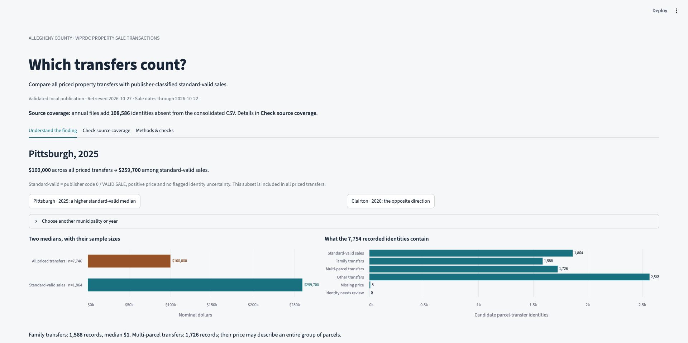

# The price story depends on which transfers count

A reproducible **Python + SQL + DuckDB** pipeline and local **Streamlit** dashboard for [Allegheny County Property Sale Transactions](https://data.wprdc.org/dataset/real-estate-sales).

**Question:** How does the apparent price picture change across municipalities when all priced property transfers are distinguished from publisher-classified standard-valid sales?

## Two findings from the October 27, 2026 snapshot

**Coverage comes first.** The consolidated file contains only **509 identities dated 2025**, while reconciliation with the annual files yields **31,551**. Across 2012–2026, annual resources add **108,586 identities** absent from the consolidated resource. This establishes a discrepancy between downloaded resources, not its upstream cause or complete real-world coverage.

**The price comparison can change in either direction.**

| Municipality and year | All priced transfers: median | Standard-valid sales: median | Standard-valid sales |
|---|---:|---:|---:|
| Pittsburgh, 2025 | \$100,000 | \$259,700 | 1,864 |
| Clairton, 2020 | \$164,000 | \$56,500 | 36 |

In Pittsburgh's 2025 records, 1,588 family transfers have a \$1 median. In Clairton's 2020 records, 173 distinct parcels share one deed reference and repeat a \$185,000 price. Such records have a different meaning from individual market sales. Category composition is descriptive evidence, not a causal decomposition of the median gap.

Standard-valid sales are a **subset of all priced transfers**: code `0` / `VALID SALE`, positive price, agreed analytical values, complete deed reference and no flagged date ambiguity. These are nominal property prices, not exclusively homes or a same-property appreciation index.

Explore the [measured findings](results/findings.md), [analytical table](results/municipality_year.csv), and [record-review evidence](results/review_records.csv).



[Opposite-direction example](docs/dashboard-clairton.jpg) · [Mobile preview](docs/dashboard-mobile.jpg)

## Run from a clean checkout

Tested with Python 3.11. No Docker, database server, API key or cloud account is needed. Installation and the initial data download need internet access.

```bash
 git clone https://github.com/raindexllc/allegheny-county-property-sales.git
 cd allegheny-county-property-sales
 python3.11 -m venv .venv
 source .venv/bin/activate
 python -m pip install -r requirements.lock
 python -m sales_pipeline
 python -m streamlit run dashboard.py
```

On Windows use `python` for your Python 3.11 interpreter and `.venv\Scripts\activate` for activation. The dashboard opens at http://127.0.0.1:8501. It can also run before a local download, using the explicitly labeled submission snapshot in `results/`.

```bash
# Rebuild saved source bytes without networking.
python -m sales_pipeline --offline

# Rebuild one specific retained raw snapshot.
python -m sales_pipeline --manifest data/manifests/<snapshot>.json

# Run synthetic behavioral tests without contacting WPRDC.
python -m pytest -q

# Deliberately refresh the checked-in submission bundle after reviewing a run.
python -m sales_pipeline.snapshot
```

All commands share the project data directory. To choose another directory, set `SALES_DATA_DIR` before running the pipeline, exporter and dashboard. Pipeline/exporter `--data-dir` overrides are also available; use the same environment setting for the dashboard.

## How it works

| Layer | Grain and purpose |
|---|---|
| Raw resources and manifest | Exact HTTP response bytes; resource ID, URL, retrieval time, size and SHA256 |
| `source_rows` | One parsed row from one resource; source overlap retained |
| `normalized` | The same source row with types, reference mappings, identity and version fingerprints |
| `clean_transfers` | One candidate parcel-transfer identity, resolution flags and analytical inclusion |
| `municipality_year` | One municipality and sale year; the required analytical output |

Python calls CKAN [`package_show`](https://data.wprdc.org/api/3/action/package_show?id=real-estate-sales), discovers the consolidated CSV and all named annual CSVs, and downloads their resource URLs. HTML resources are linked applications and are excluded. Raw files stay unchanged at `data/raw/<resource-id>/<sha256>.csv`; reusing a hash never rewrites a file.

SQL files run in order: **normalize → reconcile → aggregate → check**. A candidate identity is **parcel ID + sale date + deed book + deed page + instrument type**. CKAN `_id` is resource-local lineage, not a transaction ID. A separate fingerprint represents the normalized business fields of a source version.

The main output is [`municipality_year.csv`](results/municipality_year.csv). Coverage, review records, repeated-deed examples, classification counts and checks are supporting audit outputs. The [output dictionary](docs/OUTPUT_DICTIONARY.md) defines every analytical field.

## Three important design decisions

### 1. Reconcile resources without granting either family authority

The annual files add substantial coverage; simply appending them to the consolidated file would count overlap repeatedly. We group candidate identities and retain every source variant.

**Price or classification disagreements** are not settled by file name or CKAN row number. Their disputed values are withheld. A municipality disagreement blocks publication because there is no unambiguous aggregation group. **Descriptive-only differences** do not discard an agreed price/classification. Missing deed-key components and the same parcel/deed/instrument appearing on different sale dates also withhold identities from both price medians. These records remain candidate identities; possible corrections are flagged, not automatically merged.

**Rejected:** consolidated-only ingestion, blind concatenation, deduplicating by parcel alone, and choosing the largest `_id` or an assumed authoritative source. Source removals cannot be distinguished perfectly from coverage discrepancies without a publisher change feed.

### 2. Make geographic and classification policy explicit

[`config/municipalities.csv`](config/municipalities.csv) records all **175 observed source code/name pairs**. Forty-nine ward codes roll up to four cities, while 126 source codes pass through. This yields 130 municipality units. The four city rollup IDs are project-assigned, not asserted official county codes. Postal city does not define municipality.

[`config/sale_codes.csv`](config/sale_codes.csv) records observed descriptions and analytical grouping. It is an observed baseline, not a complete official code dictionary. Only code 0 is standard-valid; the preferential-assessment code PV is excluded from this narrow definition. Other transfers remain in the clean layer.

The all-transfer median includes every otherwise usable non-null price, including zero. The standard-valid median additionally requires code 0 and a positive price. Six mutually exclusive categories reconcile to the recorded identity count: standard-valid, family, multi-parcel, other, missing price and identity review.

**Rejected:** assuming every transfer represents market value, silently deleting unusual prices, calling the records home sales, comparing city wards with whole municipalities, or summing parcel prices into unquestioned deed dollar volume.

### 3. Rebuild and publish a verified local snapshot

At roughly 194 MB of downloaded CSVs, a full rebuild is straightforward. It applies corrections and removals without incremental watermark assumptions. Downloaded raw snapshots are retained; one writer lock covers a full CLI run. A crashed process leaves an inspectable `data/run.lock`; confirm its PID is no longer running before removing a stale lock.

The model builds a separate generation. Checks, CSVs, reports and checksums finish before one atomic pointer selects the new publication. Unchanged source hashes, snapshot date and transformation hashes reuse a verified generation. Keep the latest two successful database generations; older raw snapshots and manifests remain available for explicit rebuilds. Model failures save check results and up to 20 examples in `data/failures/`, preserving the last successful publication.

The submission exporter stages and verifies its bundle before replacing `results/`, with rollback on a replacement error. This directory replacement is distinct from the model's atomic pointer. The dashboard verifies every presented CSV on each rerun and never downloads or modifies source data.

**Rejected:** Postgres/Docker, incremental upserts, an orchestrator and a hosted database for this exercise. Historical files receive late recordings/corrections, so refreshing only the current year is insufficient.

## Checks grounded in the dataset

- Known resource inventory must remain present, including the latest baseline year; newly added consecutive years are discovered automatically.
- CSV schema and every record width are checked independently of DuckDB. The CKAN dumps have a CRLF header and LF records, so relaxed dialect parsing is necessary; `ignore_errors` remains false and parser row counts must agree.
- Price precision must be lossless at cents. Fractional municipality codes and unknown code/name pairs fail reference checks. House numbers and ZIP codes remain text.
- Dates must parse, sale dates must fit the snapshot range, and annual files must match **sale year**, not recording year.
- Observed sale-code/description pairs must match the declared baseline. A legitimate new category requires review, not an invented interpretation.
- Identities, source counts, output grain, six-category composition and standard-valid counts reconcile. Multi-parcel records never qualify as standard-valid.
- Losing at least 100 rows **and** over 20% of an older annual resource relative to the last successful publication blocks the model for investigation. Ordinary small corrections/removals remain possible. This declared guard is an anomaly threshold, not proof of completeness.

The ward mapping, annual sale-year partition, multi-parcel exclusion and coverage checks were written because of observed source behavior. See [SQL checks](sql/04_quality_checks.sql) and [tests](tests/test_pipeline.py).

Recording dates before sale dates and missing recording dates are retained and reported, not assumed fatal to this price analysis. Unknown classifications and unresolved identity concerns are visible rather than silently forced into a clean sale.

## Verification and reproducibility boundaries

The reviewed snapshot passes 24 SQL checks. All 36 behavioral tests passed in a freshly installed Python 3.11 environment; desktop and 390-pixel mobile layouts were visually inspected. These checks support the declared contracts, not a claim of complete real-world sales coverage.

Tests cover reruns, corrections, removals, source disagreements, descriptive-only changes, date ambiguities, incomplete deed keys, all four city rollups, lossy numeric inputs, unknown municipalities, latest-resource loss, historical count loss, download retry/failure, mid-fetch metadata changes, exclusive runs, retention, damaged output bundles and failed export preservation. Dashboard tests cover the two findings, filters, partial years, empty comparisons and damaged publications.

[`run_report.json`](results/run_report.json) records source inventory, totals, checks, output hashes and hashes of the Python/SQL/configuration/dependency inputs. [`manifest.json`](results/manifest.json) identifies the exact raw bytes. Repeating a saved snapshot with the same transformations reproduces the analytical CSV. A live refresh can legitimately change results. Old WPRDC URLs need not retain historical bytes, so exact historical reproduction also requires the corresponding locally retained raw snapshot.

`requirements.txt` lists direct dependencies; `requirements.lock` captures the tested full environment. To update, install the reviewed direct dependencies in a fresh Python 3.11 virtual environment, regenerate with `python -m pip freeze > requirements.lock`, and rerun tests plus a clean installation. The lock is a pinned environment listing, not a package-hash security manifest. Other operating systems remain a portability assumption until tested.

## Daily refreshes and 100× scale

At this size, schedule the same command with one writer, capture exit status and alert on failures and coverage changes. Compare resource metadata before/after fetch to catch visible mid-download refreshes. Independently published files still do not constitute a publisher transaction. Reliable ETag/Last-Modified support could reduce traffic if verified. Establish retention for raw snapshots/manifests and failure reports before long-term daily operation.

At 100× scale, stream downloads while hashing, convert landed snapshots into typed partitioned Parquet, bound memory/spill, and reprocess changed partitions while preserving full-history reconciliation. Do not average partition medians: recompute exact medians from affected underlying transfers. Shared orchestration/storage would follow operational needs; grain, lineage, disagreement handling and publication contracts remain the same.

## What was left out

No buyer/seller enrichment, assessment join, inferred residential classification, geocoding, deed-dollar-volume sum, inflation adjustment, causal model or same-property appreciation estimate. Those require additional evidence or a different question. No claim of a complete real-world sale ledger or a publisher-guaranteed transaction key. No automatic resolution of disputed analytical values. No hosted dashboard or scheduler; the application runs locally. Raw CSVs and database binaries stay out of Git; the small verified submission bundle is included.

## Code and walkthrough

Start with [`sales_pipeline/__main__.py`](sales_pipeline/__main__.py), then [`ingest.py`](sales_pipeline/ingest.py), [`model.py`](sales_pipeline/model.py), and the four numbered SQL files. [`storage.py`](sales_pipeline/storage.py) contains the shared lock, paths and publication verification. [`dashboard.py`](dashboard.py) reads only verified output. See the [walkthrough with a concrete record](docs/CODE_WALKTHROUGH.md) and [reference-data provenance](config/README.md).

Use a clean clone for the normal edit → diff → test → commit → push workflow. Inspect `git diff`, run tests, and commit the reviewed code and refreshed submission bundle together.

## AI disclosure

**OpenAI ChatGPT and Codex** assisted source investigation, analytical design, Python/SQL implementation, synthetic tests, dashboard development and documentation. Findings were calculated from programmatically downloaded WPRDC data. Synthetic test records do not enter analytical results. Browser automation assisted visual inspection. Identity assumptions, inclusion rules and reproducibility boundaries are documented for a live code walkthrough.

Sources: [WPRDC dataset and warnings](https://data.wprdc.org/dataset/real-estate-sales) · [resource dictionary](https://data.wprdc.org/dataset/real-estate-sales/resource/5bbe6c55-bce6-4edb-9d04-68edeb6bf7b1). WPRDC lists the dataset under CC0.
