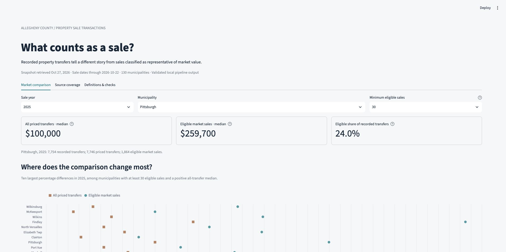

# What counts as a sale?

A reproducible **Python + SQL + DuckDB** pipeline and local **Streamlit** dashboard for [Allegheny County Property Sale Transactions](https://data.wprdc.org/dataset/real-estate-sales).

**Question:** Which municipalities' apparent property-market prices change most when all recorded transfers are distinguished from sales classified as representative of market value?

## Findings from the October 27, 2026 snapshot

Two discoveries materially changed the approach:

1. **The consolidated CSV alone misses recent coverage present in the annual files.** It contains 397,885 records, including only **509 dated 2025 and 3 dated 2026**. The annual files contribute **108,586 additional candidate transfer identities**. After reconciliation, the dataset contains **506,471 identities across 130 municipalities**, with sale dates from January 1, 2012 through October 22, 2026. This measures agreement between downloaded resources; it does not establish why records are absent or prove complete real-world sales history.
2. **Transfer classification changes the price comparison substantially.** In 2025, Pittsburgh's median across all priced transfers was **$100,000**, versus **$259,700** among **1,864 eligible sales**, out of 7,754 recorded transfer identities. Wilkinsburg's corresponding medians were **$43,034.50** and **$175,927.50**, with 64 eligible sales. Among the 63 municipalities with at least 30 eligible sales in 2025, every eligible-sale median exceeded its all-transfer median.

The two medians describe different groups. Their difference is **not** appreciation, an affordability measure, or a causal effect. These records cover property transfers, not exclusively homes. Classification and property mix can vary across municipalities and years.

Read the [full findings and annual reconciliation](results/findings.md), inspect the [analytical CSV](results/municipality_year.csv), or open the dashboard.



## Run locally

Tested with Python 3.11. No database server, Docker, API key, or cloud account is needed to run the project. Internet access is needed to install dependencies and download WPRDC resources.

```bash
python3.11 -m venv .venv
source .venv/bin/activate
python -m pip install -r requirements.lock

# Discover and download all CSVs, validate, and publish the modeled output.
python -m sales_pipeline

# Open the local dashboard at http://127.0.0.1:8501
python -m streamlit run dashboard.py
```

On Windows, activate with `.venv\Scripts\activate`. `requirements.txt` lists the five direct dependencies; `requirements.lock` records the complete tested environment.

The dashboard can also run immediately after installation using the small, checked-in submission snapshot in `results/`. It labels that snapshot explicitly. Once the pipeline runs locally, it reads the local validated publication instead. The dashboard never downloads or modifies source data.

```bash
# Repeat the last complete raw snapshot with no network access.
python -m sales_pipeline --offline

# Rebuild an earlier saved snapshot explicitly.
python -m sales_pipeline --manifest data/manifests/<snapshot>.json

# Behavioral tests use small synthetic inputs; no WPRDC connection required.
python -m pytest -q

# Refresh the small submission snapshot deliberately after reviewing a new run.
python -m sales_pipeline.snapshot
```

The current publication is selected by `data/published/current.json`; each generation contains `sales.duckdb`, `municipality_year.csv`, its raw manifest, reconciliation, and quality reports. Raw downloads and databases are excluded from Git. A run downloads about **194 MB** across 16 CSV resources in this snapshot; the published DuckDB file is approximately **224 MB**. Full refresh time depends primarily on WPRDC and network speed.

## Pipeline and table grain

The pipeline discovers resources through CKAN, lands unchanged CSVs, types and reconciles their rows in SQL, and aggregates the result by municipality and sale year.

1. **Discover and ingest:** call CKAN [`package_show`](https://data.wprdc.org/api/3/action/package_show?id=real-estate-sales), select the consolidated CSV and every resource named `YYYY Property Sales Transactions`, and fetch the resource URLs. Check that annual years are consecutive from 2012. The two HTML resources are linked applications, not transaction extracts, so they are excluded.
2. **Land raw bytes:** store each response at `data/raw/<resource-id>/<sha256>.csv`. Save the CKAN metadata unchanged as well. A manifest records resource identity, URL, retrieval time, publisher update metadata, byte count and SHA256. Never concatenate or rewrite these raw files.
3. **Load and normalize:** validate every CSV record's width, load all fields as text, then parse dates and monetary amounts in [SQL](sql/01_normalize.sql). Keep parcel, deed and instrument identifiers as text. Preserve source resource, CKAN row ID, and row position for lineage. All original fields remain in `source_rows`.
4. **Reconcile:** compare all normalized business fields, excluding resource-local `_id`. A candidate transfer identity is **parcel ID + sale date + deed book + deed page + instrument type**. A row fingerprint identifies a particular normalized version; it is not a transaction identifier. Numeric formatting such as `100000` versus `100000.0` does not create a new version.
5. **Model and check:** produce `clean_transfers` at one row per candidate transfer identity and `municipality_year` at one row per municipality and sale year. Fail publication if any required quality check has violations.
6. **Publish:** build a separate generation, close the database and finish its CSVs and reports, then atomically replace a small pointer. A failed build leaves the prior successful generation selected. Streamlit resolves that pointer once per page rerun.

The candidate identity is supported by this snapshot, not a publisher-guaranteed sale ID. **600 identities have incomplete deed references**; the clean layer flags them. The pipeline cannot prove that two distinct real-world events never share this candidate key. Every source version remains available to revisit that decision.

## Three important design decisions

### 1. Reconcile the source families before analysis

**Choice:** ingest all 2012–2026 annual resources and the consolidated resource; compare presence and field values before selecting one analytical representation.

**Why:** all 397,885 consolidated records also occur in the annual files after normalization. The annual family contains 506,554 source rows and 506,471 candidate identities. A consolidated-only approach would miss substantial recent coverage; simple concatenation would count overlapping records repeatedly.

**Conflict policy:** if a consolidated identity has one distinct version, prefer that version; otherwise use an uncontested annual version. This is a declared precedence rule, not a claim that the consolidated file is always newer. There are **78 identities with competing annual versions resolved by the consolidated version**, and **5 annual-only identities remain unresolved**. For those five, the clean layer retains the shared identity and municipality but withholds disputed price/classification. They count as recorded identities and contribute to neither price median. All competing records are exposed in `conflict_records`; the unresolved examples are also in [results](results/unresolved_conflicts.csv).

**Rejected alternatives:** consolidated-only ingestion, blindly appending every CSV, deduplicating by parcel ID, or interpreting a larger CKAN `_id` as a later correction. A parcel can sell repeatedly; `_id` belongs to a resource and may change on reload. A conflicting consolidated identity blocks publication rather than selecting an arbitrary winner.

### 2. Separate recorded transfers from a deliberately narrow market-sale subset

**Choice:** eligible means `SALECODE = '0'`, its observed description is `VALID SALE`, price is positive, and the identity has no unresolved conflict. Retain other transfer types in the clean layer with an eligibility reason.

**Why:** WPRDC explicitly warns that many transfers do not represent market value and that a multi-parcel price can represent an entire deed. The observed codes include family transfers, multi-parcel transfers, corrective deeds and sales not analyzed. `PV`, described as a valid preferential-assessment category, is excluded from this narrow standard-code definition; 33 such identities occur in this snapshot. Two standard-valid records with zero prices are also excluded from the market subset, but retained as transfers.

The all-transfer benchmark includes every resolved, non-null price, **including zero-dollar prices**. Missing and unresolved prices do not enter either median; separate counts make those omissions visible. There are no arbitrary upper-price caps and no deletion of valid-looking low-priced transactions merely because they are unusual.

Roll up the ward codes of Pittsburgh, Clairton, Duquesne and McKeesport to their cities. This reduces **175 source geographic codes to 130 municipalities**. Use the municipality fields, not postal city. The dictionary calls both `MUNICODE` and `MUNIDESC` municipality names, but the observed code/name relationships distinguish them.

**Rejected alternatives:** treating every row as a market sale, using average prices or summed parcel prices as an unquestioned market indicator, dropping unusual prices, comparing city wards against whole municipalities, or silently calling these home sales. The dashboard's default 30-sale threshold is a display rule, not statistical proof of representativeness.

### 3. Rebuild a validated local snapshot instead of incremental upserts

**Choice:** content-addressed raw snapshots, explicit SQL, and full modeled rebuilds in DuckDB. Streamlit reads only the completed output and reports. The model has no wall-clock timestamps in its analytical rows.

**Why:** at this size, rebuilding is straightforward and applies changed values and removals without retaining stale rows. It avoids pretending that resource IDs, file names or sale dates are reliable change-data-capture keys. An unchanged source snapshot produces the same analytical CSV bytes.

**Rejected alternatives:** Postgres/Docker, dbt, an orchestrator, and an incremental watermark based solely on sale year. They add setup or state-management work without improving this exercise. Historical years can receive late entries and corrections, so refreshing only the current year would miss changes.

## Quality checks that fail

[SQL checks](sql/04_quality_checks.sql) count violations; any nonzero count raises `QualityError` and prevents publication. Checks include:

- Required parcel/date/geography fields, parcel identifier shape, parse failures and negative prices.
- Annual source year matches **sale year**, not recording year.
- Observed sale-code/description pairs match the reviewed [code map](config/sale_codes.csv); a new or changed category requires review.
- Ward descriptions agree with the city rollup, and each identity has one municipality.
- Consolidated identity is unambiguous; clean identity and output grain are unique.
- Every source identity is represented, and clean counts reconcile to analytical counts.
- Unresolved values never enter price metrics, and multi-parcel `H` records never qualify as eligible market sales.

**Checks written because of this dataset:** the annual-sale-year check, city-ward label check, code/description map, and multi-parcel exclusion check address observed source behavior. The annual files actually partition by `SALEDATE`; the data dictionary's text describes dates as `dd/mm/yyyy`, while the downloaded CSVs use ISO dates. The code map preserves `OTHER` as a publisher description rather than inventing a meaning for those codes.

The CKAN dump has **CRLF on the header and LF on records**. DuckDB's strict dialect sniffing rejects this mixed-newline format. Python's CSV reader first checks the schema and every record's width; DuckDB then reads with relaxed dialect handling, **without ignoring errors**. Counts must match the independent CSV scan. No rejected row is silently skipped.

Not every anomaly is a pipeline failure: zero or missing prices can be legitimate non-market records; missing recording dates remain null. **730 resolved records have recording dates before sale dates**. They are retained, counted in the run report, and excluded from any claim about a trustworthy recording-lag distribution. This project does not use recording lag as its analytical question.

The [tests](tests/test_pipeline.py) demonstrate repeatability, corrected values, source removals, repeated parcel sales, multi-parcel deeds, conflict handling and failure preservation. Deliberately malformed prices/dates, unknown classifications, wrong annual years and wrong ward labels raise actual errors. Dashboard tests exercise the checked-in snapshot, filters, warnings and downloads.

## Verification performed

- A complete initial download and a second complete refresh produced the same analytical CSV SHA256: `86351460b912e56e1d2de7406f9fcc0641490ed7ab46001cdcdfa850e8707e55`.
- Synthetic correction and removal tests change the selected output without duplicating or retaining old transfers.
- Corrupted raw bytes fail checksum verification; omitted manifest resources fail inventory verification.
- The 19 SQL quality checks pass on the real snapshot. The analytical table contains **1,947 municipality-year rows**; combinations with no recorded transfers are absent, not filled with invented prices.
- The dashboard was opened and visually inspected locally. Its default is the latest completed calendar year in the snapshot; selecting 2026 shows a partial-year warning.

The small [run report](results/run_report.json), [source manifest](results/manifest.json) and [quality report](results/quality_checks.csv) accompany the output. Source hashes allow comparison with this submission; WPRDC's live resource URLs do not guarantee that an old version will remain downloadable. Offline reproduction requires retaining the corresponding raw snapshot locally.

## Updates, daily refreshes and 100× scale

**Current refresh behavior:** rediscover all resources, download all CSVs, retain changed bytes under new hashes, and rebuild from that complete snapshot. Recheck resource metadata after downloading; if it changed during the fetch, fail and retry. This reduces mixed-refresh risk but does not make independently published files a transactional snapshot. New annual years are discovered automatically; missing intermediate years or schema changes stop the run. Corrections and deletions apply within each source; a record retained by the other source remains evidence under the declared reconciliation policy. There is no publisher deletion feed to distinguish an intentional deletion from a coverage discrepancy.

**Daily at current scale:** schedule this same command with one writer at a time, capture exit status, alert on failure and material count/coverage changes, retain the last successful output, and set raw/generation retention. Use reliable ETag or Last-Modified support if verified; do not trust dates alone as content identity. Review new classification codes before publication. Refresh old years too, or periodically reconcile full history.

**At 100× scale:** stream downloads to disk while hashing instead of holding each response in memory; convert the landed snapshots into typed, partitioned Parquet; bound DuckDB memory and spill to disk; reprocess affected partitions after identifying changed resources. Exact medians cannot be combined by averaging municipality or partition medians: recompute from the affected underlying transfers. Preserve full-history reconciliation and explicit removals. Move orchestration/storage to shared infrastructure only when operational requirements justify it; the same grain, lineage and publication contracts still apply.

## What I did not do, and why

- No buyer/seller enrichment, property assessment join, geocoding or external property-type data: the chosen question stays within one dataset.
- No attempt to reconstruct a complete historical sale ledger or establish a legally authoritative transfer identity: the source does not guarantee either.
- No deed-level dollar-volume total: parcel prices can repeat the total for a multi-parcel deed.
- No inferred residential classification, inflation adjustment, causal interpretation, or same-property appreciation model: those need additional evidence and a different question.
- No automatic decision on the five unresolved identities and no invented interpretation of ambiguous validation codes.
- No claim that recording date equals WPRDC publication time, or that 2026 is a completed year.
- No hosted dashboard, cloud database or scheduler. The public repository and local run are sufficient; Streamlit is an additional way to explore the required table.
- No raw-data files or DuckDB binary in Git. They are downloaded programmatically and retained locally; the repository contains the small, inspected submission results.

## Repository map and live walkthrough

| File | Responsibility |
|---|---|
| [`sales_pipeline/ingest.py`](sales_pipeline/ingest.py) | CKAN discovery, unchanged raw landing and checksums |
| [`sales_pipeline/model.py`](sales_pipeline/model.py) | CSV loading, SQL execution, failure gates and publication |
| [`sql/01_normalize.sql`](sql/01_normalize.sql) | Types, candidate identity, version fingerprint and geography |
| [`sql/02_reconcile.sql`](sql/02_reconcile.sql) | Source precedence, conflicts and clean transfer layer |
| [`sql/03_municipality_year.sql`](sql/03_municipality_year.sql) | The one analytical output table |
| [`sql/04_quality_checks.sql`](sql/04_quality_checks.sql) | Failing data-quality assertions |
| [`dashboard.py`](dashboard.py) | Read-only local presentation |
| [`tests/`](tests/) | Synthetic pipeline scenarios and dashboard checks |

See the [code walkthrough](docs/CODE_WALKTHROUGH.md) and [output dictionary](docs/OUTPUT_DICTIONARY.md).

## AI disclosure

**OpenAI ChatGPT and Codex were used** for source investigation, discussing analytical choices, drafting and revising Python/SQL, creating synthetic tests, implementing the Streamlit dashboard, and drafting documentation. Findings were calculated from programmatically downloaded WPRDC resources and checked against SQL output; they were not supplied by the model from memory. Synthetic fixtures are explicitly labeled and are not included in analytical results. Browser automation assisted local visual inspection.

AI assistance does not remove the need to understand and defend the code, identity assumptions, classification choices and limitations during a live walkthrough.

## Source documentation

- [WPRDC dataset and publisher warnings](https://data.wprdc.org/dataset/real-estate-sales)
- [Consolidated resource data dictionary](https://data.wprdc.org/dataset/real-estate-sales/resource/5bbe6c55-bce6-4edb-9d04-68edeb6bf7b1)
- [CKAN package metadata endpoint](https://data.wprdc.org/api/3/action/package_show?id=real-estate-sales)

The dataset is listed by WPRDC under CC0. This repository adds transformations and analysis; it does not establish ownership of the underlying public records.
